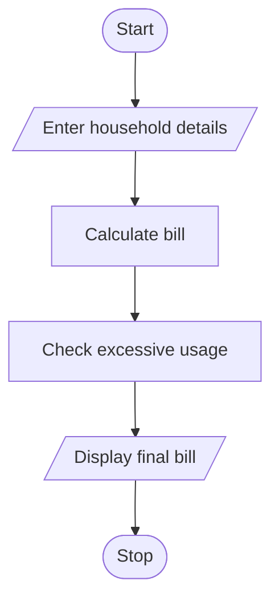

# 25. Progressive Water Tariff Analysis

## 1. PROBLEM STATEMENT

Write a Python program to calculate water bills for multiple households using consumption slabs, fixed fees, and penalties. Compare household water consumption and identify excessive usage.

## 2. ALGORITHM

1. Start the program.
2. Enter the number of households.
3. Enter household name and water consumption.
4. Calculate charges using consumption slabs.
5. Add fixed fee and penalty.
6. Identify excessive water usage.
7. Display the total bill for each household.
8. Stop the program.

## 3. FLOWCHART 

## 5. SAMPLE INPUT

Enter number of households: 2

Household 1
Enter household name: Arshad
Enter water consumption: 150

Household 2
Enter household name: Rahul
Enter water consumption: 250

## 6. SAMPLE OUTPUT

Household: Arshad
Consumption: 150 units
Total Water Bill: Rs. 400
Status: Normal Usage

Household: Rahul
Consumption: 250 units
Total Water Bill: Rs. 950
Status: Excessive Usage

