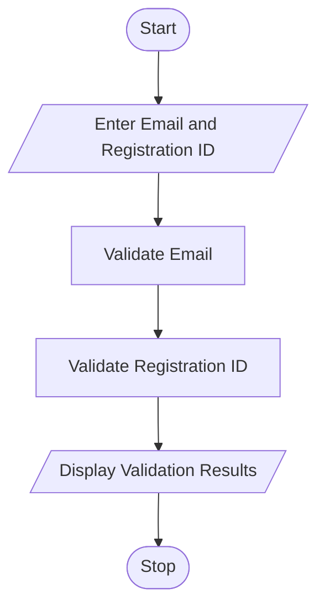

# 30. Student Email and Identifier Validation Using Python

## 1. Problem Statement
Write a Python program to validate student email addresses and registration identifiers based on given formatting rules.
The program should check:
- Whether the student email contains a valid username and domain.
- Whether the email has a proper `@` symbol and dot (`.`).
- Whether the email contains invalid characters or malformed separators.
- Whether the registration ID contains valid letters and numbers.
- Whether any required components are missing.
Finally, display whether the email and registration ID are valid or invalid.
## 2. Algorithm
1. Start the program.
2. Read the student email address.
3. Read the student registration ID.
4. Check whether the email contains exactly one `@` symbol.
5. Check whether the username and domain are present.
6. Check whether the email contains a valid domain and extension.
7. Check for invalid characters and consecutive separators.
8. Validate the registration ID using the given format.
9. Display the validation results.
10. Stop the program.

## 3. Flowchart

## 5. Sample Input

Enter student email: student123@college.com
Enter registration ID: CSE2026001

## 6. Sample Output

--- Validation Results ---
Valid Email
Valid Registration ID

