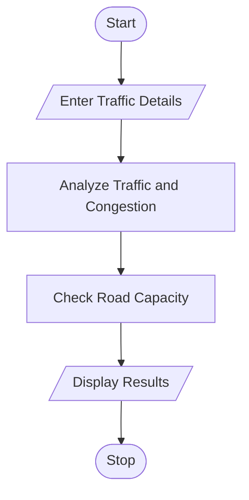

# 40. Traffic Flow and Congestion Analysis Using Python

## 1. Problem Statement

Write a Python program to analyze traffic flow on multiple roads at different time intervals. The program calculates the peak traffic period, classifies congestion levels as Low, Medium, or High, and identifies roads that exceed their capacity limits.

## 2. Algorithm

1. Start the program.
2. Enter the number of roads.
3. Enter the road names and vehicle counts for different time intervals.
4. Calculate the total number of vehicles on each road.
5. Find the peak traffic period.
6. Classify congestion levels:
   - Below 50 vehicles – Low
   - 50 to 100 vehicles – Medium
   - Above 100 vehicles – High
7. Compare vehicle counts with road capacity.
8. Display traffic analysis results.
9. Stop the program.

## 3. Flowchart 

## 5. Sample Input

Enter number of roads: 2

Enter road name: Main Road
Enter road capacity: 100
Enter vehicles in time interval 1: 40
Enter vehicles in time interval 2: 120
Enter vehicles in time interval 3: 80

Enter road name: College Road
Enter road capacity: 150
Enter vehicles in time interval 1: 30
Enter vehicles in time interval 2: 60
Enter vehicles in time interval 3: 90

## 6. Sample Output

--- Traffic Analysis Report ---

Road: Main Road
Total Vehicles: 240
Peak Traffic: 120
Peak Period: 2
Congestion Level: High
Status: Exceeds Capacity

Road: College Road
Total Vehicles: 180
Peak Traffic: 90
Peak Period: 3
Congestion Level: Medium
Status: Within Capacity

