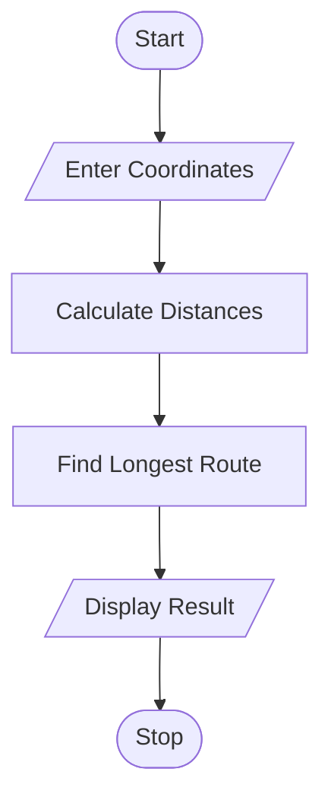

# 50. Tuple-Based Route Distance Analysis Using Python

## 1. Problem Statement

Write a Python program to store geographical coordinates as tuples and calculate the distances between successive points using a given formula. Identify and display the longest route segment.

## 2. Algorithm

1. Start the program.
2. Enter the number of geographical points.
3. Store latitude and longitude as tuples.
4. Calculate the distance between successive points using the distance formula.
5. Find the longest route segment.
6. Display all distances and the longest segment.
7. Stop the program.

## 3. Flowchart

## 5. Sample Input

Enter number of points: 3

Enter latitude: 0
Enter longitude: 0

Enter latitude: 3
Enter longitude: 4

Enter latitude: 6
Enter longitude: 8

## 6. Sample Output

Distance between (0.0, 0.0) and (3.0, 4.0) = 5.0

Distance between (3.0, 4.0) and (6.0, 8.0) = 5.0

Longest Route Segment:
(0.0, 0.0) to (3.0, 4.0)

Longest Distance: 5.0

