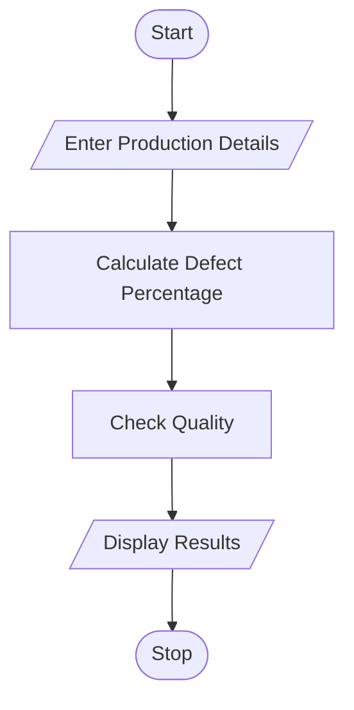

# 60. Manufacturing Quality Control Matrix Using Python

## 1. Problem Statement

Write a Python program to analyze production quantities and defective units across different products and batches. Calculate defect percentages and identify batches that exceed the quality threshold.

## 2. Algorithm

1. Start the program.
2. Enter the number of products and batches.
3. Enter production quantity and defective units.
4. Calculate the defect percentage.
5. Compare the defect percentage with the quality threshold.
6. Identify batches exceeding the threshold.
7. Display the results.
8. Stop the program.

## 3. Flowchart

## 5. Sample Input

Enter number of products: 2

Enter product name: Laptop
Enter number of batches: 2

Batch 1
Enter production quantity: 1000
Enter defective units: 80

Batch 2
Enter production quantity: 500
Enter defective units: 10

Enter product name: Mobile
Enter number of batches: 2

Batch 1
Enter production quantity: 800
Enter defective units: 20

Batch 2
Enter production quantity: 600
Enter defective units: 60

## 6. Sample Output

Defect Percentage: 8.0 %
Status: Quality Threshold Exceeded

Defect Percentage: 2.0 %
Status: Quality Accepted

Defect Percentage: 2.5 %
Status: Quality Accepted

Defect Percentage: 10.0 %
Status: Quality Threshold Exceeded

Quality Control Analysis Completed

