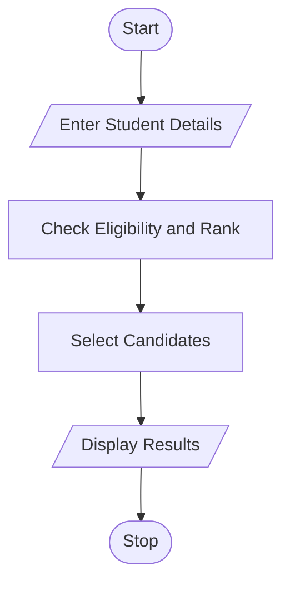

# 70. Multi-Stage Scholarship Shortlisting Using Python

## 1. Problem Statement

Write a Python program to shortlist students for scholarships based on academic marks, attendance percentage, family income, and ranking rules. Select eligible students according to a fixed scholarship quota.

## 2. Algorithm

1. Start the program.
2. Enter the number of students and scholarship quota.
3. Enter student name, marks, attendance, and family income.
4. Check academic eligibility (minimum 75% marks).
5. Check attendance (minimum 75%).
6. Check family income (below ₹2,50,000).
7. Rank eligible students based on marks.
8. Select students according to the scholarship quota.
9. Display the selected students.
10. Stop the program.

## 3. Flowchart

## 5. Sample Input

Enter number of students: 4
Enter scholarship quota: 2

Student 1
Enter student name: Ravi
Enter academic marks: 85
Enter attendance percentage: 90
Enter family income: 200000

Student 2
Enter student name: Priya
Enter academic marks: 92
Enter attendance percentage: 95
Enter family income: 180000

Student 3
Enter student name: Kumar
Enter academic marks: 70
Enter attendance percentage: 80
Enter family income: 150000

Student 4
Enter student name: Anu
Enter academic marks: 88
Enter attendance percentage: 85
Enter family income: 220000

## 6. Sample Output

--- Scholarship Selected Students ---

1 Priya - Marks: 92.0
2 Anu - Marks: 88.0

Total Eligible Students: 3
Total Selected Students: 2

