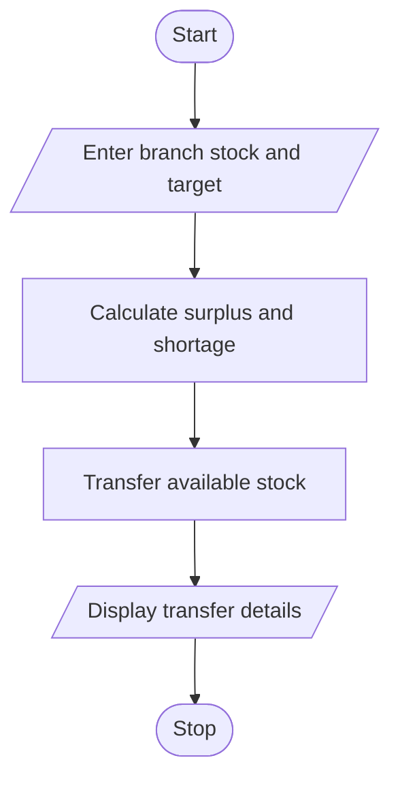

# 88. Multi-Branch Retail Inventory Transfer

## 1. PROBLEM STATEMENT

Write a Python program to compare stock levels of multiple retail branches with their target stock levels. Calculate surplus and shortage for each branch and transfer available stock from surplus branches to shortage branches while following transfer constraints.

## 2. ALGORITHM

1. Start the program.
2. Enter the number of branches.
3. Enter the current stock and target stock for each branch.
4. Calculate surplus and shortage.
5. Identify branches with surplus stock.
6. Identify branches with shortage stock.
7. Transfer stock from surplus branches to shortage branches.
8. Check the maximum transfer limit.
9. Display the final transfer details.
10. Stop the program.

## 3. FLOWCHART

## 5. SAMPLE INPUT

Enter number of branches: 3

Branch 1
Enter current stock: 150
Enter target stock: 100

Branch 2
Enter current stock: 60
Enter target stock: 100

Branch 3
Enter current stock: 80
Enter target stock: 100

Enter maximum transfer quantity: 30

## 6. SAMPLE OUTPUT

--- STOCK TRANSFERS ---

Branch 1 to Branch 2 : 30 units
Branch 1 to Branch 2 : 10 units
Branch 1 to Branch 3 : 10 units

--- FINAL STOCK STATUS ---

Branch 1 Stock: 150
Branch 2 Stock: 60
Branch 3 Stock: 80

