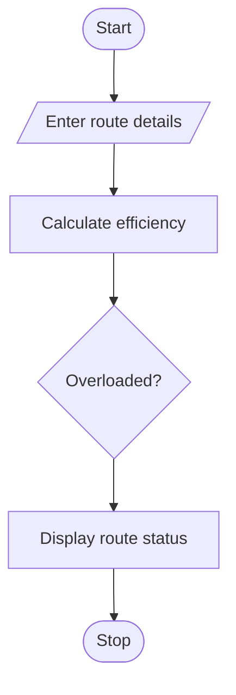

# 80. Multi-Day Bus Route Performance Analysis

## 1. PROBLEM STATEMENT

Write a Python program to analyse bus route performance over multiple days using passenger demand, journey time, fuel usage, and bus capacity. Identify overloaded routes and compare operating efficiency based on passenger capacity and fuel consumption.

## 2. ALGORITHM

1. Start the program.
2. Enter the number of routes.
3. Enter passengers, journey time, fuel usage, and bus capacity.
4. Calculate passenger demand and fuel efficiency.
5. Identify overloaded routes.
6. Compare route efficiency.
7. Display the results.
8. Stop the program.

## 3. FLOWCHART

## 5. SAMPLE INPUT

Enter number of routes: 2

Route 1
Enter number of days: 2
Day 1
Enter passengers: 60
Enter journey time: 2
Enter fuel used: 10
Day 2
Enter passengers: 70
Enter journey time: 2
Enter fuel used: 12
Enter bus capacity: 60

Route 2
Enter number of days: 2
Day 1
Enter passengers: 40
Enter journey time: 3
Enter fuel used: 8
Day 2
Enter passengers: 45
Enter journey time: 3
Enter fuel used: 9
Enter bus capacity: 60

## 6. SAMPLE OUTPUT

--- ROUTE PERFORMANCE ---

Route: 1
Total Passengers: 130
Journey Time: 4.0
Fuel Used: 22.0
Efficiency: 5.91
Status: Overloaded

Route: 2
Total Passengers: 85
Journey Time: 6.0
Fuel Used: 17.0
Efficiency: 5.0
Status: Normal

Most Fuel Efficient Route: 1
