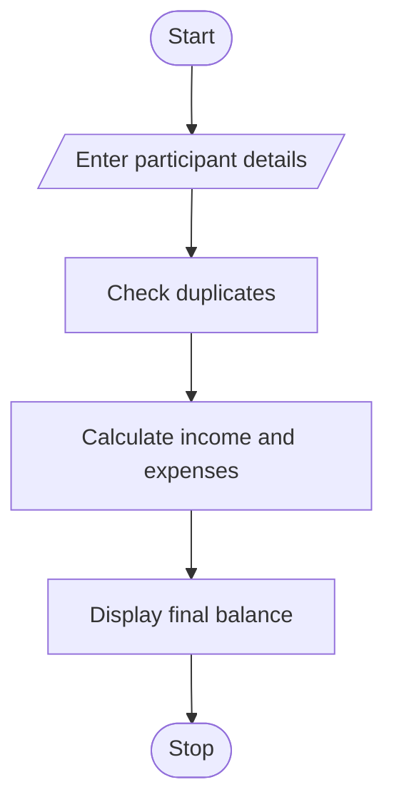

# 74. Campus Festival Registration and Financial Audit

## 1. PROBLEM STATEMENT

Write a Python program to manage campus festival registrations and financial records. Check participant details, detect duplicate registrations, calculate registration fees, sponsorship contributions, total expenses, and final financial balance.

## 2. ALGORITHM

1. Start the program.
2. Enter participant registration details.
3. Check duplicate registrations.
4. Calculate registration fee.
5. Enter sponsorship amount and expenses.
6. Calculate total income and balance.
7. Display the financial report.
8. Stop the program.

## 3. FLOWCHART

## 5. SAMPLE INPUT

Enter number of participants: 4
Enter registration fee per person: 500

Enter participant name: Arshad
Enter participant name: Rahul
Enter participant name: Suresh
Enter participant name: Arshad
Duplicate registration: Arshad

Enter sponsorship amount: 10000
Enter total expenses: 5000

## 6. SAMPLE OUTPUT

--- FESTIVAL FINANCIAL AUDIT ---

Valid Participants: ['Arshad', 'Rahul', 'Suresh']
Total Registrations: 3
Registration Income: 1500.0
Sponsorship: 10000.0
Total Income: 11500.0
Total Expenses: 5000.0
Final Balance: 6500.0

