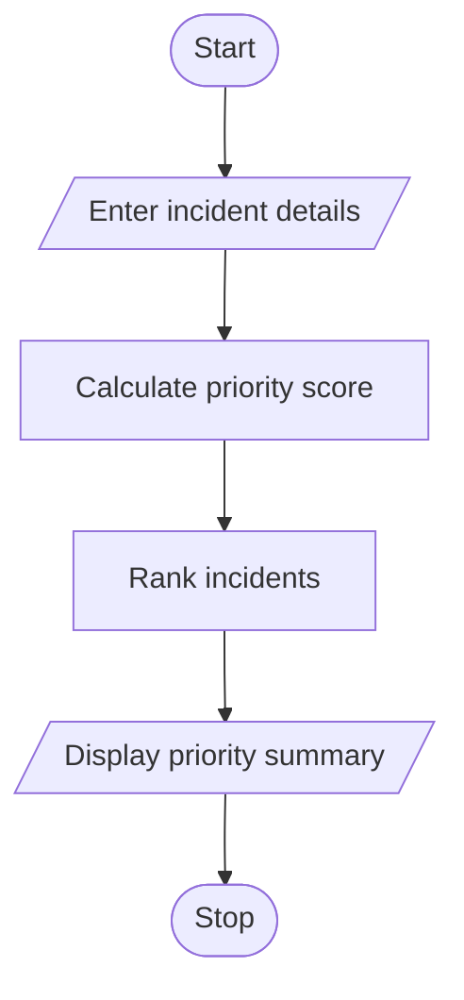

# 97. Smart Campus Incident and Maintenance Prioritization

## 1. PROBLEM STATEMENT

Write a Python program to classify campus maintenance reports based on severity, location, and reported frequency. Rank incidents according to priority rules and display a priority summary.

## 2. ALGORITHM

1. Start the program.
2. Enter the number of incidents.
3. Enter incident name, severity, location, and frequency.
4. Calculate priority score.
5. Classify incidents based on priority.
6. Sort incidents by priority score.
7. Display the priority summary.
8. Stop the program.

## 3. FLOWCHART 

 

## 5. SAMPLE INPUT

Enter number of incidents: 3

Incident 1
Enter incident name: Water Leakage
Enter severity (1-5): 5
Enter location: Hostel
Enter reported frequency: 4

Incident 2
Enter incident name: Fan Repair
Enter severity (1-5): 2
Enter location: Classroom
Enter reported frequency: 2

Incident 3
Enter incident name: Power Failure
Enter severity (1-5): 4
Enter location: Library
Enter reported frequency: 3

## 6. SAMPLE OUTPUT

--- PRIORITY SUMMARY ---

Incident: Water Leakage
Location: Hostel
Score: 23
Priority: High Priority

Incident: Power Failure
Location: Library
Score: 18
Priority: Medium Priority

Incident: Fan Repair
Location: Classroom
Score: 10
Priority: Low Priority

