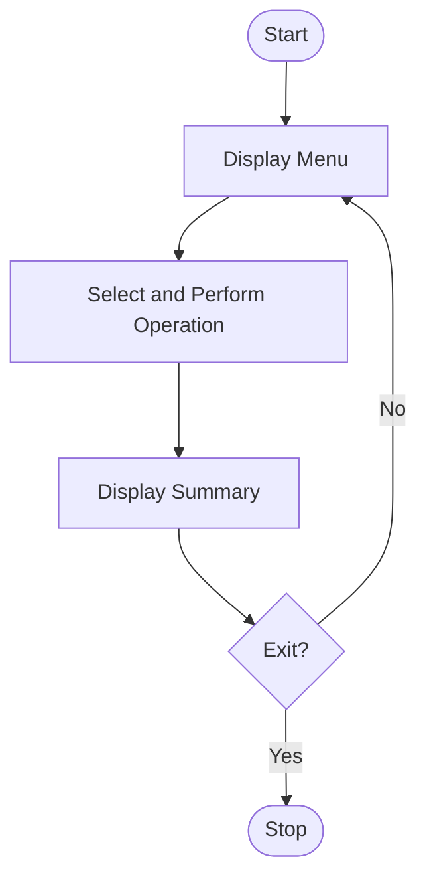

# 100. Comprehensive Smart Campus Management Simulation

## 1. PROBLEM STATEMENT

Write a Python menu-driven program to manage a smart campus by integrating student records, attendance, marks, event registration, and resource allocation. Generate summary reports using conditional statements, loops, strings, lists, nested lists, tuples, and tuple unpacking.

## 2. ALGORITHM

1. Start the program.
2. Display the campus management menu.
3. Enter student details.
4. Record attendance and marks.
5. Register students for events.
6. Allocate campus resources.
7. Display student and campus reports.
8. Repeat until the user selects Exit.
9. Stop the program.

## 3. FLOWCHART

## 5. SAMPLE INPUT

--- SMART CAMPUS MANAGEMENT ---
1. Student Records
2. Attendance
3. Marks
4. Event Registration
5. Resource Allocation
6. Summary Report
7. Exit

Enter your choice: 1
Enter student name: Arshad
Enter roll number: 196
Student added successfully

Enter your choice: 2
Enter roll number: 196
Attendance recorded

Enter your choice: 3
Enter roll number: 196
Enter marks: 85
Marks updated

Enter your choice: 4
Enter roll number: 196
Enter event name: Hackathon
Event registered

Enter your choice: 5
Enter resource name: Computer
Enter allocated room: Lab 1
Resource allocated

Enter your choice: 6

## 6. SAMPLE OUTPUT

--- CAMPUS SUMMARY ---

Name: Arshad
Roll No: 196
Attendance: 1
Marks: 85
Result: Pass

Event Registrations: [('196', 'Hackathon')]

Resource Allocations: [('Computer', 'Lab 1')]

Total Students: 1

Enter your choice: 7
Exiting Campus Management

